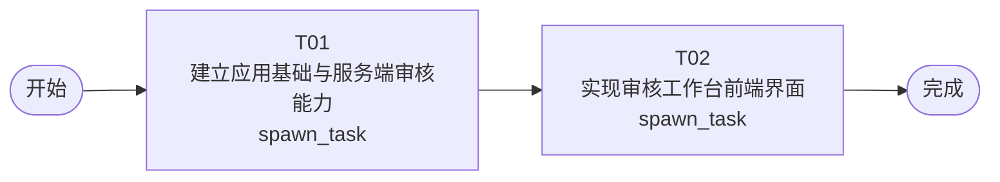

# 开发任务编排

<!-- sourcePlanId: plan:81df26b4-843a-41b7-afbd-acdd7f91d799 | rendererVersion: 4 -->

## 任务

| 任务 | 一句话目标 | 执行模式 | 依赖 | 能力 |
| --- | --- | --- | --- | --- |
| T01 | 建立应用基础与服务端审核能力 | spawn_task | - | engineering.implementation |
| T02 | 实现审核工作台前端界面 | spawn_task | T01 | engineering.implementation |

## 依赖执行图

## 任务契约

### T01

**目标**

## 目标

在空白仓库中建立可运行的 AI 审核工作台基础与服务端能力：单进程 Hono 服务、目录型文件存储、串行审核队列、OpenAI 兼容模型调用、GitHub/GitLab 变更拉取适配器、确定性测试实现与启动恢复。

## 范围

- 应用基础：根 `package.json`（含 `dev:web`、`dev:server`、`build`、`start`、`verify` 脚本，以及服务端与前端各自所需的依赖声明）、`package-lock.json`、`.gitignore`、`README.md`。
- 服务端按 `docs/wi-t1000011/architecture-baseline.md` 第 2.1 节的模块职责落地；接口字段、错误码与状态迁移以 `docs/wi-t1000011/technical-contract.md` 为准，不在本任务重复定义字段清单。
- 实现 `REVIEW_ENGINE=stub`、`PLATFORM_FETCH_MODE=stub`、`REVIEW_STEP_DELAY_MS` 三个只从服务端环境变量读取的确定性开关，供后续验收使用；默认值不改变产品行为。
- 前端产物尚未构建时服务端仍可启动：非 `/api` 请求按 404 处理，不因缺少 `dist/` 崩溃。
- `scripts/` 下提供 API 级验收脚本，使用独立临时 `DATA_DIR` 与空闲端口自启自清，覆盖健康检查、凭证保存与脱敏读取及清除、粘贴创建并推进到成功、链接模式失败原因与不产生记录、失败重试、记录删除、启动时中断记录恢复。

## 交付边界

- 不实现 `src/web/`、`index.html`、`vite.config.ts`、`tsconfig.json`；前端由后续任务完成。
- `data/` 为运行时产物，不提交业务数据文件。

## 验证

- 运行 `npm install` 生成锁文件后启动服务，执行上述验收脚本并报告真实结果；补充 `node --check` 一类的启动与语法检查。
- 报告未能覆盖的场景（例如真实平台与真实模型调用）作为残余风险，不宣称已验证。

**角色:** general-app-development-expert  \  **失败策略:** block

**需求**

- AC-01
- AC-02
- AC-03
- AC-04
- AC-05
- AC-06

**输入**

- docs/wi-t1000011/requirements.md
- docs/wi-t1000011/architecture-baseline.md
- docs/wi-t1000011/technical-contract.md

**产物**

- package.json
- package-lock.json
- src/server.js
- src/server/
- scripts/

**可写范围**

- package.json
- package-lock.json
- src/server.js
- src/server/
- scripts/
- README.md
- .gitignore

**阻塞码**

- TASK_FAILED

### T02

**目标**

## 目标

实现 React 18 + TypeScript + Vite 工作台前端，消费已实现的服务端接口完成新建审核、审核历史、结果详情与平台设置的完整交互。

## 范围

- 按 `docs/wi-t1000011/architecture-baseline.md` 第 1.3 节全局 UI 基线与 2.2 节前端模块实现应用壳、四个页面与展示组件。
- 接口类型、字段与错误码到文案的映射以 `docs/wi-t1000011/technical-contract.md` 为准；不自行发明接口行为或本地推断审核结果。
- 交付 `src/web/`（入口、应用壳、页面、组件、`api` 客户端与类型声明）、根 `index.html`、`vite.config.ts`（开发期将 `/api` 代理到服务端 `PORT`，构建输出 `dist/`）、`tsconfig.json`。
- 关键状态需在界面上可区分：审核进行中定时刷新（1.5 秒，进入终态停止）、未发现问题、审核失败原因与重新发起、拉取失败就地提示、凭证未配置跳转设置、列表加载骨架与空态。

## 交付边界

- 不修改 `package.json`、`package-lock.json` 与 `src/server/`；若前端依赖在共享清单中缺失，向本阶段报告阻塞，不自行改写共享清单。

## 验证

- 运行 `npx tsc --noEmit` 与 `npm run build`，确认类型检查通过且构建产物落在 `dist/`。
- 报告真实结果，并说明未覆盖的运行期交互与视觉项。

**角色:** general-app-development-expert  \  **失败策略:** block

**需求**

- AC-01
- AC-02
- AC-03
- AC-04
- AC-05
- AC-06

**输入**

- docs/wi-t1000011/requirements.md
- docs/wi-t1000011/architecture-baseline.md
- docs/wi-t1000011/technical-contract.md
- package.json (来自 T01)

**产物**

- src/web/
- index.html
- vite.config.ts
- tsconfig.json

**可写范围**

- src/web/
- index.html
- vite.config.ts
- tsconfig.json

**阻塞码**

- TASK_FAILED
